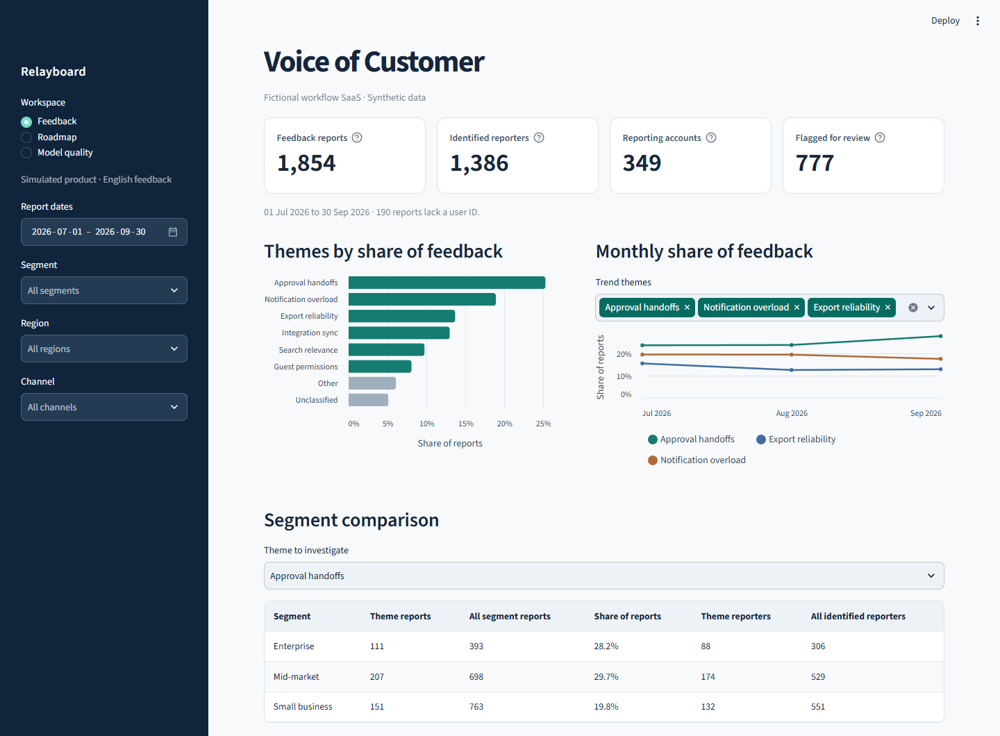
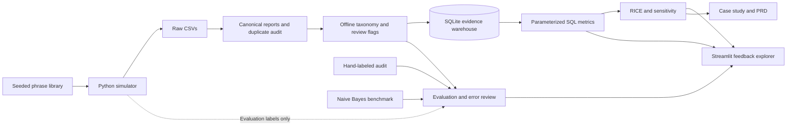

# AI-Powered Voice of Customer & Product Prioritization

[Open interactive dashboard](https://8tludvqky9kh7nc4t3jxtb.streamlit.app/) · [Read the portfolio case study](https://itssmit1773-code.github.io/portfolio/voice-of-customer.html)

**Decision:** prototype a way to recover stalled approvals in Relayboard, a fictional global workflow SaaS product. In the July–September 2026 simulation, approval handoffs accounted for **469 of 1,854** deduplicated reports (**25.3%**) and came from **394 identified reporters across 235 accounts**. The proposal led the base RICE ranking at **144.1**. Under adverse assumptions, a notification digest can overtake it.

[Case study](docs/case-study.md) · [Approval recovery PRD](docs/prd-approval-recovery.md) · [Data dictionary](docs/data-dictionary.md) · [Model evaluation](docs/model-evaluation.md) · [Decision method](docs/prioritization.md)



## Open the dashboard

1. Install [Python 3.12](https://www.python.org/downloads/) if needed. On Windows, select **Add Python to PATH** in the installer.
2. Extract the project folder. Open a terminal in the folder containing this README.
3. Run the commands below. On Windows, you can double-click **Open dashboard.cmd** after installing Python 3.12. The first launch installs the free packages into the project folder.

**Windows PowerShell**

```powershell
py -3.12 -m venv .venv
.\.venv\Scripts\python.exe -m pip install -r requirements.txt
.\.venv\Scripts\python.exe -m streamlit run app.py --server.address 127.0.0.1
```

**macOS / Linux**

```bash
python3.12 -m venv .venv
.venv/bin/python -m pip install -r requirements.txt
.venv/bin/python -m streamlit run app.py --server.address 127.0.0.1
```

If the browser stays closed, visit **http://127.0.0.1:8501**. Stop the dashboard with **Ctrl+C** in its terminal. The included database makes the dashboard ready to explore after setup. It uses no account, API key, or paid service.

## Reproduce the analysis

From the project folder, run the following with the environment's Python. On Windows substitute `.\.venv\Scripts\python.exe` for `python`. On macOS or Linux substitute `.venv/bin/python`.

```bash
python -m voc.pipeline
python -m unittest discover -s tests -v
```

The pipeline uses only Python's standard library. It regenerates the source extracts, classifications, SQLite warehouse, evaluation and roadmap exports under `artifacts/`. Pass `--output path/to/folder` to build a separate copy. The manifest records hashes for the source inputs and generated files. CSV and JSON outputs are reproducible under the tested Python 3.12 environment. SQLite binary hashes can vary with SQLite versions.

## Explore the decision

- **Feedback** filters reports by date, channel, segment and region. Compare themes and trends, inspect label-level evidence, and download the filtered records. The date filter starts on the decision quarter. Select April to see the full six months.
- **Roadmap** holds the scoring cohort fixed. Compare low, base and high planning inputs, inspect effort and eligibility, and see where the leading rank can change.
- **Model quality** compares the chosen taxonomy and a statistical baseline on the same 24 hand-labeled audit cases. Inspect the confusion matrix and the rows that require review.

## Architecture



| Path | Contents |
|---|---|
| `data/` | Authored feedback library, labeled development and audit examples, decision assumptions |
| `voc/` | Data generation, canonicalization, classification, validation, SQL access and RICE |
| `sql/` | SQLite schema and named reporting queries |
| `artifacts/` | Source extracts, SQLite database, metric and evaluation exports, lineage manifest |
| `tests/` | Unit, pipeline, reconciliation and dashboard tests |
| `docs/` | Case study, stakeholder brief, methodology, PRD and portfolio handoff |

## Data and project boundaries

All product records, labels, and planning assumptions are fictional. The generator deliberately increases approval feedback in later months and assigns channel and segment sampling weights. Counts describe the demonstration cohort. They cannot estimate population prevalence, future adoption, revenue or realized impact. The repository uses English lexical classification with human review for uncertain or sensitive rows. The approval feature is a proposed product design. See [portfolio handoff](docs/portfolio-handoff.md) for website copy and interview notes.
